<p align="center">
  
</p>

<p align="center">
  <strong>Your work, remembered. Your computer, understood.</strong>
</p>

<p align="center">
  
  
  
  
</p>

Companion is a minimalist, always-on-top AI assistant for Windows. It lives quietly at the top of the screen, expands on hover, understands your calendar and email, listens when you push to talk, and can carry out approved actions on your computer.

## What it can do

- **Talk naturally** through ChatGPT, the Gemini API, or a local Ollama model, with automatic fallback.
- **See your screen on request** and reason about the active display without saving screenshots.
- **Manage your day** through Google Calendar, Gmail summaries, local tasks, reminders, and memory.
- **Act on Windows** by opening apps, typing text, controlling media, and completing multi-step work.
- **Research the web** before answering questions that need current information or real prices.
- **Transcribe locally** with Faster-Whisper so push-to-talk audio does not need a cloud speech service.
- **Stay in your control** with Suggest, Confirm, and Trusted action modes.

## Model routing

| Mode | Behaviour |
| --- | --- |
| **Auto** | Tries ChatGPT, then Gemini, then Ollama. |
| **ChatGPT** | Uses an eligible ChatGPT plan through OAuth; no OpenAI API key is stored. |
| **Gemini** | Uses a Gemini API key encrypted for the current Windows account. |
| **Local** | Keeps inference on-device through Ollama. |

## Quick start

Requirements: Windows 10/11, Node.js 20+, Python 3.10+, and optionally [Ollama](https://ollama.com/).

```powershell
npm install
python -m pip install -r scripts/requirements-voice.txt
npm run dev
```

For a production build:

```powershell
npm run build
npm start
```

`npm run build` compiles the app; `npm start` launches it.

## Connect services

### ChatGPT

Open **Settings → Intelligence → Connect with ChatGPT**, or run:

```powershell
npm run connect:chatgpt
```

The connection uses OAuth with PKCE. Availability depends on your ChatGPT plan and your organization's delegated-access policy.

### Gemini API

Create a restricted key in Google AI Studio, then open **Settings → Intelligence**, paste it into the Gemini field, and select **Gemini**. The key is validated before it is encrypted with Windows safe storage; it is never returned to the renderer or committed to Git.

### Google Calendar and Gmail

1. Create a **Desktop app** OAuth client in Google Cloud.
2. Enable the **Google Calendar API** and **Gmail API**.
3. In Companion settings, add the client ID and client secret.
4. Connect each Google account and choose the primary account.

Google credentials are stored with Windows safe storage and excluded from Git.

### Ollama

Install a model and keep Ollama running:

```powershell
ollama pull qwen2.5:7b
ollama serve
```

Select **Local** in Companion settings, then choose the installed model.

## Privacy by design

- Screen awareness is disabled until explicitly enabled.
- A screen image is captured only for a direct screen-aware request.
- Screenshots are sent directly to the selected ChatGPT or Gemini model and are not written to disk.
- The Companion window is capture-protected so it does not recursively photograph itself.
- OAuth tokens and application secrets use Windows encrypted safe storage.
- Ollama and Faster-Whisper remain available for local inference and transcription.
- Model requests use `store: false` where supported.

## Architecture

```text
Floating React UI
       │
Electron preload bridge
       │
Main-process agent router
  ├── ChatGPT OAuth + Responses API
  ├── Gemini API
  ├── Ollama local inference
  ├── Google Calendar + Gmail
  ├── Faster-Whisper transcription
  ├── Screen capture + media session
  └── Windows actions + local SQLite memory
```

## Commands

| Command | Purpose |
| --- | --- |
| `npm run dev` | Build the main process and launch with the Vite renderer. |
| `npm run build` | Create the production build. |
| `npm start` | Launch the production build. |
| `npm test` | Compile and run the Node test suite. |
| `npm run verify:google` | Verify the Google integration. |
| `npm run verify:agent` | Verify the research agent. |

## Status

Companion is an early Windows-first project. Review actions before using Trusted mode, especially for destructive or account-changing operations.

<p align="center"><sub>Built to feel present, not intrusive.</sub></p>
